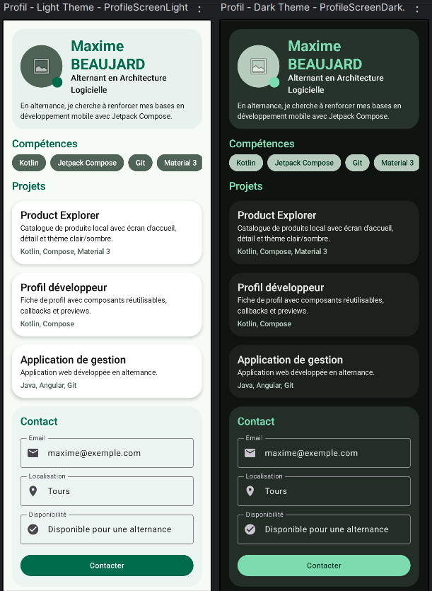

# Profil développeur – Amélioration UI

## Description

Cette application Android affiche le profil d'un développeur (le mien : alternant en Architecture Logicielle) avec **Jetpack Compose** et **Material Design 3**.

L'écran présente :

- un en-tête avec un avatar (placeholder), un badge, le nom, le rôle et une courte description ;
- une liste horizontale de compétences ;
- une liste verticale de projets ;
- une zone de contact (email, localisation, disponibilité) et un bouton « Contacter ».

Les données sont **locales** : elles sont écrites directement dans le code Kotlin (`sampleDeveloper()`, `sampleSkills()`, `sampleProjects()`). L'application n'utilise ni API, ni ViewModel, ni navigation, ni stockage.

Le clic sur « Contacter » appelle un callback (`onContactClick`) qui ne contient qu'un commentaire : l'action sera ajoutée plus tard.

Tout le code de l'interface se trouve dans `MainActivity.kt`. Le thème est dans `ui/theme/` (`Theme.kt`, `Type.kt`, `Color.kt`).

## Composants Compose utilisés

| Composant | Utilisation |
|---|---|
| `Text` | Nom, rôle, description, titres de sections, informations des projets |
| `Button` | Bouton « Contacter » (`ContactButton`) |
| `Icon` | Icônes email, localisation et disponibilité dans les champs de contact |
| `Image` | Avatar placeholder (`AvatarWithBadge`) |
| `Card` | Carte de chaque projet (`ProjectCard`) |
| `OutlinedTextField` (lecture seule) | Champs de contact : email, localisation, disponibilité (`ContactField`) |
| `Surface` | En-tête, section contact, avatar, badge et compétences (`SkillChip`) |
| `Scaffold` | Structure de l'écran et gestion de `innerPadding` |

## Layouts utilisés

- **`Column`** : organise verticalement l'en-tête, les sections et le contenu des cartes.
- **`Row`** : aligne l'avatar et le nom/rôle sur une même ligne (`ProfileHeader`).
- **`Box`** : superpose le badge sur l'avatar, avec `Modifier.align(Alignment.BottomEnd)` (`AvatarWithBadge`).
- **`Spacer`** : gère les espaces entre les éléments.
- **`Surface`** : crée des zones visuelles cohérentes avec le thème (formes, couleurs, élévation).
- **`LazyColumn`** et **`LazyRow`** : listes, détaillées ci-dessous.

## Listes affichées avec LazyColumn et LazyRow

### `LazyColumn` : écran principal et liste de projets

`ProfileScreen` est une `LazyColumn` unique qui assemble toutes les sections :

1. `item { ProfileHeader(...) }` : l'en-tête ;
2. `item { SkillsSection(...) }` : les compétences ;
3. `item { Text("Projets") }` : le titre de la section ;
4. `items(items = projects, key = { project -> project.id })` : un `ProjectCard` par projet ;
5. `item { ContactSection(...) }` : le contact.

`item` ajoute un élément unique, `items` parcourt une collection. Chaque projet est affiché par le composable réutilisable `ProjectCard`, qui ne connaît qu'un seul projet. Le paramètre `key` (l'`id` du projet) donne une identité stable à chaque élément de la liste.

### `LazyRow` : liste de compétences

`SkillsSection` affiche les compétences dans une `LazyRow` avec `items(items = skills, key = { skill -> skill.id })`. Chaque compétence est affichée par le composable réutilisable `SkillChip`. L'espacement entre les éléments est géré par `Arrangement.spacedBy(8.dp)`.

## Choix de thème (Material Design 3)

Le thème `ProductExplorerTheme` (`ui/theme/Theme.kt`) centralise l'apparence : les composants utilisent `MaterialTheme.colorScheme`, `MaterialTheme.typography` et `MaterialTheme.shapes` au lieu de couleurs ou tailles écrites en dur.

- **Couleurs (`ColorScheme`)** : une palette verte, avec une version claire (`LightColorScheme`) et une version sombre (`DarkColorScheme`). Elles définissent les rôles `primary`, `secondary`, `background`, `surface`, `onPrimary`, `onBackground` et `onSurface`. Le vert donne une identité sobre, et les couleurs `on...` garantissent un texte lisible sur chaque fond.
- **Clair / sombre** : `isSystemInDarkTheme()` choisit automatiquement la palette. La couleur dynamique (Material You) est désactivée pour que l'application garde sa propre palette sur Android 12+. Deux previews permettent de comparer les rendus.
- **Typographie (`ProductTypography`)** : cinq styles personnalisés pour la hiérarchie du texte, du plus important au moins important : `headlineMedium` (28 sp, gras) pour le nom, `titleLarge` (20 sp) pour les titres de sections et de projets, `titleMedium` (16 sp) pour le rôle, `bodyMedium` (14 sp) pour les descriptions, `labelLarge` (14 sp) pour les compétences et les technologies.
- **Formes (`ProductShapes`)** : des coins arrondis de 8, 16, 24 et 32 dp. `shapes.large` est utilisé pour les cartes et les zones, `shapes.extraLarge` pour les compétences en forme de pastille.
- **Mise en valeur** : `primary` met en avant le nom et les titres de sections, `secondary` les technologies des projets.

## Previews

Deux previews sont disponibles dans `MainActivity.kt` :

- `ProfileScreenLightPreview` : thème clair ;
- `ProfileScreenDarkPreview` : thème sombre.

## Capture d'écran

## Quelles notions du chapitre Compose UI avez-vous réutilisées dans cette application ?

J'ai réutilisé les notions des TP 4 à 7 :

- **Composants fondamentaux** : `Text`, `Button`, `Icon`, `Image`, `Card` et `OutlinedTextField` en lecture seule, comme pour la garantie dans l'écran de détail produit.
- **Layouts** : `Column`, `Row`, `Box` (avatar et badge), `Spacer` et `Surface`, comme dans l'écran d'accueil.
- **Listes modernes** : `LazyColumn` avec `item` / `items` et `key`, et `LazyRow` pour les compétences, comme dans le catalogue de produits.
- **Composants réutilisables** : `SkillChip`, `ProjectCard` et `ContactField` reçoivent leurs données en paramètres et acceptent un `modifier: Modifier = Modifier`. Le parent décide du placement, et les callbacks signalent les clics.
- **Material Design 3** : `ColorScheme`, `Typography`, `Shapes`, thème clair et sombre, comme pour la personnalisation graphique.
- **Previews** : une preview claire et une preview sombre pour vérifier le rendu dans les deux thèmes.
